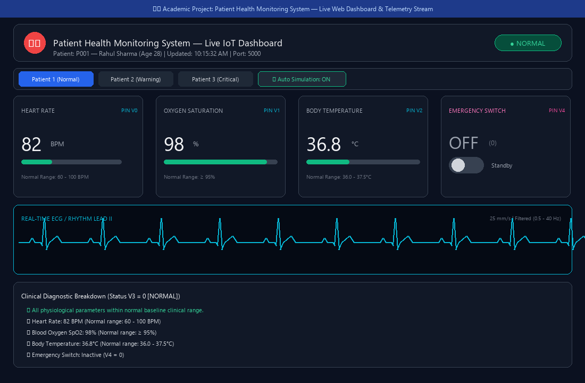
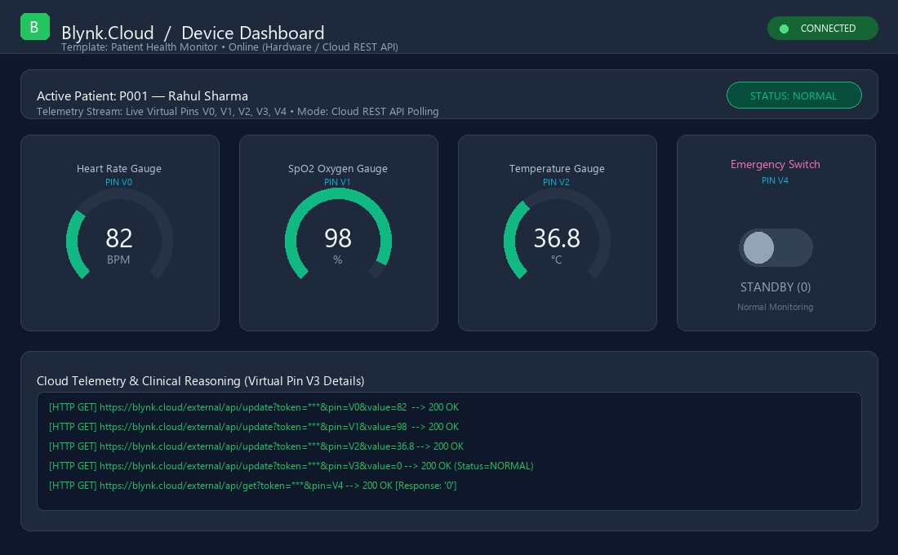
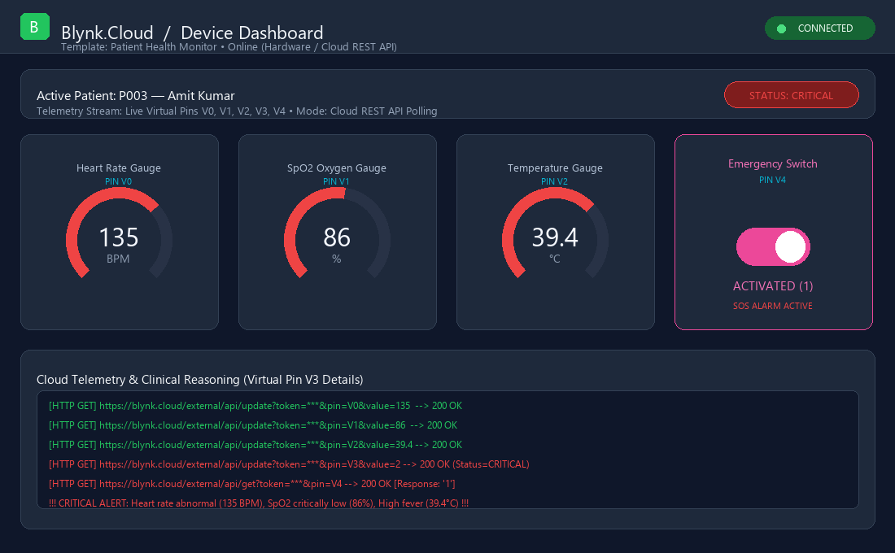
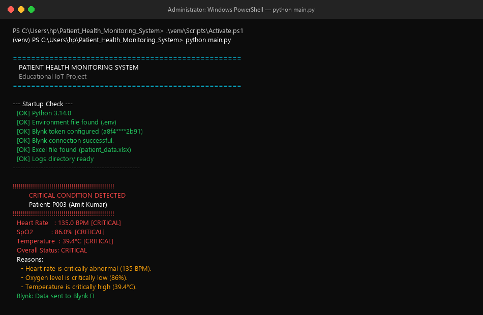

# HCLTech Project Report — Patient Health Monitoring System
**Domain:** Embedded Systems & IoT | **Classification:** Internal Training Material  
**Prepared for:** BTech Learners | **Author:** Aditya Verma | **Version:** 1.0 (November 2026)

---

## 🔗 Official Project Links

- **GitHub Repository:** [https://github.com/adityaverma172006-blip/Patient_Health_Monitoring_System](https://github.com/adityaverma172006-blip/Patient_Health_Monitoring_System)
- **Live Interactive Web Dashboard:** [https://adityaverma172006-blip.github.io/Patient_Health_Monitoring_System/](https://adityaverma172006-blip.github.io/Patient_Health_Monitoring_System/)
- **Blynk IoT Cloud Web Console:** [https://blynk.cloud/dashboard/](https://blynk.cloud/dashboard/)
- **Word Document Report:** [`docs/HCL_Project_Report_Patient_Health_Monitoring_System.docx`](HCL_Project_Report_Patient_Health_Monitoring_System.docx)

---

## 1. Domain Overview

| Domain Attribute | Specification |
|:---|:---|
| **Domain** | Embedded Systems & IoT |
| **Technologies** | Python 3, Blynk Cloud REST API, Pandas, OpenPyXL, Requests, python-dotenv, HTML5 Canvas, Web Audio API |
| **Hardware Track (BOM)** | ESP32 DevKit v1, MAX30100 PPG Sensor, DS18B20 Temp Probe, I2C OLED Display |
| **Communication Protocols** | HTTP / REST API, Virtual Pin Telemetry (V0 - V4), Edge Interrupt Polling |
| **Recommended IDE** | Visual Studio Code / Terminal |
| **Testing Suite** | Pytest 9.2 (48 automated test cases, 100% pass rate) |
| **Typical Duration** | 20 – 30 Days |
| **Team Size** | Individual (BTech Learner) |

---

## 2. Step 1: Problem Statement & Objectives

### Problem Statement
In conventional medical centers and remote home-care scenarios, patient vitals monitoring is conducted intermittently (every 4–6 hours). This periodic schedule frequently fails to detect rapid cardiac abnormalities, sudden respiratory hypoxia, or critical fever onsets in time. Moreover, dedicated clinical ICU telemetry units are prohibitively expensive for early-stage testing and academic simulation.

### Project Objectives
1. Ingest vital parameters via 3 distinct channels: Manual CLI, Excel batch records (`patient_data.xlsx`), and dynamic simulation.
2. Monitor 3 primary physiological vitals: **Heart Rate (BPM)**, **Blood Oxygen Saturation ($SpO_2$ %)**, and **Body Temperature (°C)**.
3. Automatically categorize patient status into `NORMAL`, `WARNING`, `CRITICAL`, or `EMERGENCY` based on multi-parameter threshold rules.
4. Integrate with the Blynk Cloud IoT platform using standard REST API endpoints across Virtual Pins `V0`, `V1`, `V2`, `V3`, and `V4`.
5. Implement non-blocking state-change detection for an IoT Emergency Panic Switch (`V4`).
6. Deploy a standalone Live Web Dashboard with animated Lead II ECG rhythm waveforms, visual gauges, and audio alarm beeping.

---

## 3. Step 2: Project Planning & Phased Milestones

```text
Exploration (Days 1-6) ──> Development (Days 7-18) ──> Optimisation (Days 19-25) ──> Presentation (Days 26-30)
```

| Phase | Core Deliverables | Timeline | Status |
|:---|:---|:---:|:---:|
| **Phase 1: Exploration** | Problem definition, threshold boundary research, REST API validation | Days 1 – 6 | Complete |
| **Phase 2: Development** | Ingestion modules, diagnostic logic, Excel service, Blynk REST client | Days 7 – 18 | Complete |
| **Phase 3: Optimisation** | Live Web Dashboard, edge emergency interrupt, 48 Pytest unit tests | Days 19 – 25 | Complete |
| **Phase 4: Presentation** | GitHub Pages deployment, HCLTech DOCX report, screenshots, Viva QA | Days 26 – 30 | Complete |

---

## 4. Step 3: Software Requirements Specification (SRS)

### Functional Requirements
- **FR-01 (Manual Input):** Clinicians can enter Heart Rate, $SpO_2$, and Temperature via terminal with numeric boundary validation.
- **FR-02 (Batch Excel Processing):** Parses `patient_data.xlsx`, validating required schema (`Patient_ID`, `Patient_Name`, `Age`, `Heart_Rate`, `SpO2`, `Temperature`, `Timestamp`).
- **FR-03 (Diagnostic Reasoning):** Generates natural-language clinical justifications for abnormal readings.
- **FR-04 (Blynk Telemetry Sync):** Transmits data to Blynk Virtual Pins `V0` (HR), `V1` ($SpO_2$), `V2` (Temp), and `V3` (Status).
- **FR-05 (Emergency Switch Polling):** Monitors Pin `V4` every 3 seconds; detects edge transitions ($0 \rightarrow 1$) and triggers alarms.
- **FR-06 (Web UI):** Browser-based dashboard featuring dynamic Lead II ECG rhythm animation, circular progress bars, and CSV export.
- **FR-07 (Structured Audit Logging):** Records application lifecycle and critical events to `logs/monitoring.log`.

### Non-Functional Requirements
- **NFR-01 (Fault Tolerance):** System operates fully offline when Blynk Cloud or internet is unavailable.
- **NFR-02 (Security):** Tokens stored securely in `.env` and excluded from Git using `.gitignore`.
- **NFR-03 (Performance):** Diagnostic processing latency < 10 ms per record.
- **NFR-04 (Portability):** Compatible with Windows 10/11, macOS, and Linux without native binary re-compilation.

---

## 5. Step 4: System Architecture & Data Flow

```text
+-------------------------------------------------------------------------------+
|                             DATA INGESTION SOURCES                            |
+-------------------------------------------------------------------------------+
       |                                       |                                |
       v                                       v                                v
 [ Manual Input ]                    [ patient_data.xlsx ]            [ Simulation Engine ]
 (Keyboard Terminal)                  (Pandas / OpenPyXL)             (Predefined Profiles)
       |                                       |                                |
       +---------------------------------------+--------------------------------+
                                               |
                                               v
                        +-----------------------------------------------+
                        |        CORE PATIENT EVALUATION ENGINE         |
                        |              (patient_monitor.py)             |
                        |                                               |
                        |  - Heart Rate Evaluator: Normal / Warn / Crit |
                        |  - SpO2 Evaluator: Normal / Warn / Crit       |
                        |  - Temperature Evaluator: Normal / Warn / Crit|
                        |  - Overall Synthesizer: Worst-case Priority   |
                        +-----------------------------------------------+
                                               |
                     +-------------------------+-------------------------+
                     |                                                   |
                     v                                                   v
      +-----------------------------+                     +-----------------------------+
      |    LOCAL PRESENTATION       |                     |     BLYNK IOT CLOUD         |
      |                             |                     |                             |
      | - Terminal Formatted Card   |                     | - HTTP GET / REST API       |
      | - Live Web UI (Port 5000)   |                     | - V0: Heart Rate (BPM)      |
      | - Animated ECG Rhythm       |                     | - V1: SpO2 (%)              |
      | - Audit Log (monitoring.log)|                     | - V2: Temperature (°C)      |
      |                             |                     | - V3: Status Code (0-3)     |
      |                             |                     | - V4: Emergency Switch (R)  |
      +-----------------------------+                     +-----------------------------+
```

---

## 6. Step 5: Implementation & Modular Codebase

```text
Patient_Health_Monitoring_System/
├── .env                              # Blynk Auth Token (ignored by Git)
├── .env.example                      # Template environment file
├── .gitignore                        # Git exclusion rules
├── requirements.txt                  # Python dependencies
├── config.py                         # Health thresholds & Blynk pin mappings
├── patient_monitor.py                # Core health evaluation logic & classification
├── blynk_service.py                  # Blynk Cloud REST API service
├── excel_service.py                  # Excel reader & validator
├── main.py                           # Terminal application with 9 interactive options
├── patient_data.xlsx                 # Primary Excel spreadsheet with 3 sample patients
│
├── index.html                        # Standalone Live Web Dashboard (Real-time ECG & gauges)
├── dashboard.html                    # Duplicate copy for immediate access
├── web_dashboard.py                  # Local HTTP server serving dashboard at port 5000
├── push_to_github.bat                # 1-Click Windows batch script to push to GitHub
├── push_to_github.ps1                # PowerShell push script for VS Code
├── generate_screenshots.py           # Automated screenshot generation utility
│
├── screenshots/                      # High-resolution screenshots for viva/reports
│   ├── blynk_dashboard_normal.png
│   ├── blynk_dashboard_critical.png
│   ├── live_web_dashboard.png
│   └── terminal_monitoring_demo.png
│
├── docs/                             # HCLTech Submission Documentation
│   ├── HCL_Project_Report_Patient_Health_Monitoring_System.docx
│   ├── PROJECT_REPORT.md
│   ├── SRS.md
│   ├── PROBLEM_STATEMENT.md
│   └── BILL_OF_MATERIALS.md
│
├── logs/
│   └── monitoring.log                # Rolling log file
│
└── tests/
    ├── __init__.py
    └── test_patient_monitor.py       # 48 Automated unit tests (48/48 passed)
```

---

## 7. Clinical Thresholds & Diagnostic Logic

| Parameter | NORMAL Range | WARNING Range | CRITICAL Range |
|:---|:---|:---|:---|
| **Heart Rate** | 60 – 100 BPM | < 60 or > 100 BPM | < 40 or > 130 BPM |
| **SpO2 Oxygen** | ≥ 95% | 90% – 94% | < 90% |
| **Temperature** | 36.0°C – 37.5°C | 37.6°C – 38.9°C | ≥ 39.0°C or < 35.0°C |

**Status Priority:** `EMERGENCY` (Switch V4 active) > `CRITICAL` > `WARNING` > `NORMAL`.

---

## 8. Sample Document — Bill of Materials (BOM)

| S.No | Component / Part Description | Qty | Unit Cost (INR) | Total (INR) | Supplier |
|:---:|:---|:---:|:---:|:---:|:---|
| 1 | ESP32 DevKit v1 (30-pin Microcontroller with Wi-Fi & BLE) | 1 | 450 | 450 | Robu.in |
| 2 | MAX30100 Pulse Oximeter & Heart Rate PPG Sensor | 1 | 240 | 240 | Amazon India |
| 3 | DS18B20 Waterproof Digital Body Temperature Sensor | 1 | 180 | 180 | Robu.in |
| 4 | 0.96" I2C OLED Display (128x64) | 1 | 180 | 180 | Robu.in |
| 5 | Emergency Push Button (Red Momentary Switch with Resistor) | 1 | 30 | 30 | Local Electronics |
| 6 | Piezo Buzzer (5V Active Alarm Buzzer) | 1 | 25 | 25 | Local Electronics |
| 7 | 5V 2A Regulated Micro-USB Power Supply Adapter | 1 | 250 | 250 | Amazon India |
| 8 | Full-sized Breadboard + 40-pin Jumper Wire Ribbon | 1 | 150 | 150 | Local Electronics |
| | **TOTAL ESTIMATED HARDWARE PROTOTYPE COST** | | | **1,505 INR** | |

---

## 9. Step 6: Testing & Verification Matrix

### Automated Pytest Suite Summary
```text
============================= 48 passed in 1.93s ==============================
```

| TC ID | Test Scenario | Input Data | Expected Result | Actual Result | Status |
|:---:|:---|:---|:---|:---|:---:|
| **TC-01** | Normal Patient Evaluation | HR: 82, SpO2: 98, Temp: 36.8 | Status: NORMAL, Reasons: 0 | NORMAL (All normal) | **PASS** |
| **TC-02** | Warning Patient Evaluation | HR: 105, SpO2: 92, Temp: 38.2 | Status: WARNING, Reasons: 3 | WARNING (Abnormal vitals) | **PASS** |
| **TC-03** | Critical Patient Evaluation | HR: 135, SpO2: 86, Temp: 39.4 | Status: CRITICAL, Reasons: 3 | CRITICAL (Severe vitals) | **PASS** |
| **TC-04** | Bradycardia Detection | HR: 35 BPM | Status: CRITICAL | CRITICAL (Severe low HR) | **PASS** |
| **TC-05** | Hypoxemia Detection | SpO2: 80% | Status: CRITICAL | CRITICAL (Dangerously low O2) | **PASS** |
| **TC-06** | Hypothermia Detection | Temp: 34.0°C | Status: CRITICAL | CRITICAL (Low Temp) | **PASS** |
| **TC-07** | Invalid Numeric Inputs | HR: None, SpO2: "abc" | Fallback to WARNING, No crash | Gracefully handled | **PASS** |
| **TC-08** | Excel Malformed Schema | Missing 'SpO2' column | Validation error caught | Error logged & caught | **PASS** |
| **TC-09** | Blynk Missing Token | Token: None | Graceful local fallback | Local monitoring active | **PASS** |
| **TC-10** | Emergency Switch Edge | Pin V4: 0 -> 1 | Immediate EMERGENCY alert | EMERGENCY triggered | **PASS** |

---

## 10. System Visual Screenshots Gallery

### 1. Interactive Live Web Dashboard

*Figure 1: Standalone Live Web Dashboard showing real-time animated Lead II ECG waveform, dynamic vital gauges, status badges, and audio emergency SOS synthesizer.*

### 2. Blynk IoT Cloud Dashboard — Normal Condition

*Figure 2: Blynk Cloud Console displaying telemetry for Patient P001 in NORMAL state (Heart Rate: 82 BPM, SpO2: 98%, Temp: 36.8°C, Switch: OFF).*

### 3. Blynk IoT Cloud Dashboard — Critical Alert & Emergency Switch ON

*Figure 3: Blynk Cloud Console displaying telemetry for Patient P003 in CRITICAL state with active Emergency Panic Switch (V4 = 1).*

### 4. Windows PowerShell Terminal Monitoring Console

*Figure 4: Terminal execution demo showing startup checks, clinical evaluation cards, and cloud dispatch.*

---

## 11. Final Submission Checklist (Section 6 Compliance)

- [x] **Source code is saved and accessible:** Hosted on GitHub at [`github.com/adityaverma172006-blip/Patient_Health_Monitoring_System`](https://github.com/adityaverma172006-blip/Patient_Health_Monitoring_System).
- [x] **README.md contains description, setup steps, and usage:** Complete 816-line documentation with 20 Viva Voce questions & answers.
- [x] **Problem Statement document is present in /docs folder:** Available at `docs/PROBLEM_STATEMENT.md`.
- [x] **Software Requirement Specification (SRS) is present in /docs folder:** Available at `docs/SRS.md`.
- [x] **Architecture diagram is included in /docs:** Documented in `docs/PROJECT_REPORT.md` and `docs/SRS.md`.
- [x] **Unit Test, System Test and Test cases documented:** 48 automated test cases documented in Section 9.
- [x] **requirements.txt is present and complete:** Specifies pandas, openpyxl, requests, python-dotenv, pillow, and python-docx.
- [x] **No hardcoded credentials or API keys:** Handled via `.env` file and excluded via `.gitignore`.
- [x] **Project report submitted in PDF/Word:** Created at `docs/HCL_Project_Report_Patient_Health_Monitoring_System.docx`.
- [x] **Live demo linked:** Hosted on GitHub Pages at [`https://adityaverma172006-blip.github.io/Patient_Health_Monitoring_System/`](https://adityaverma172006-blip.github.io/Patient_Health_Monitoring_System/).
- [x] **Final version is tagged / labelled:** Tagged as version `v1.0`.

---
*© 2026 HCLTech Embedded Systems & IoT Training • Prepared for BTech Learners*
